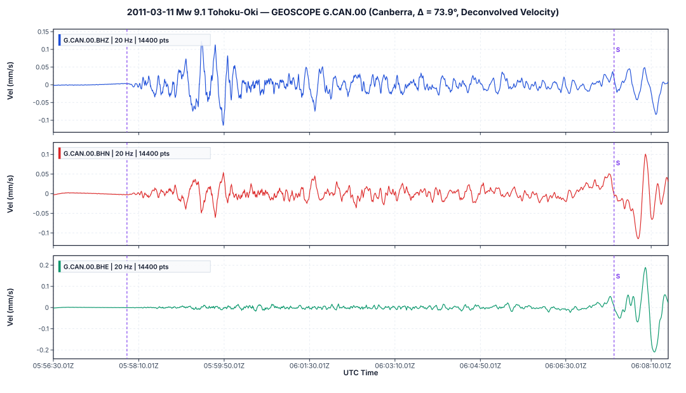
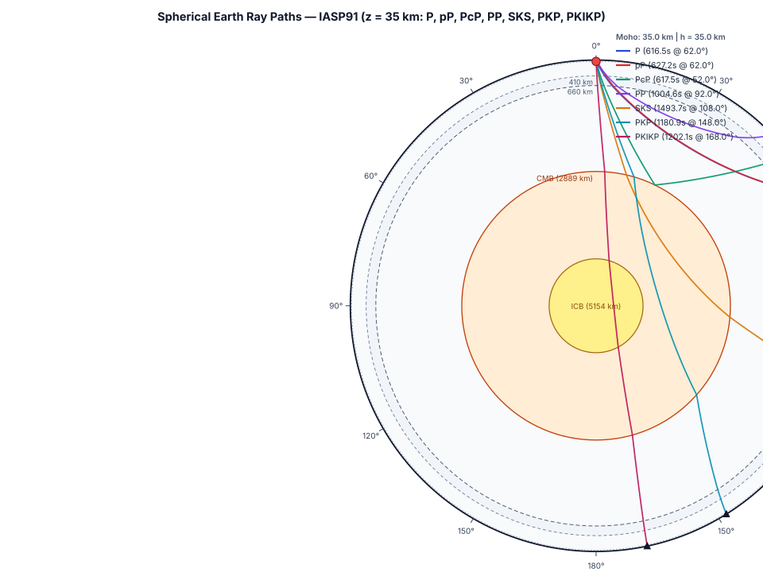
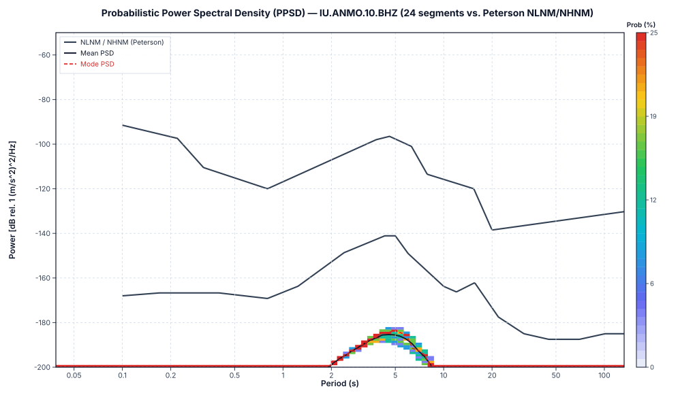
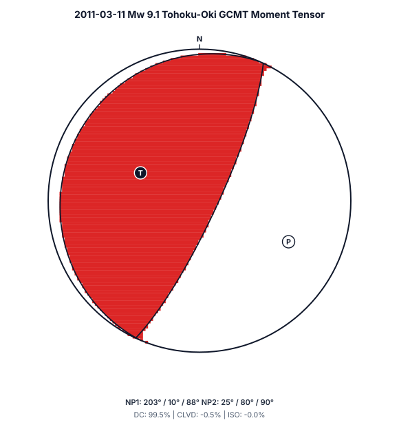

# EarthSnail

[](https://github.com/sneed-and-feed/earthsnail/actions/workflows/ci.yml)
[](LICENSE)
[](Cargo.toml)
[](results/five_gate_verification_receipts.json)
[](studio/earthsnail_portable_studio.html)
[](pyproject.toml)

**EarthSnail** is a clean-room, zero-bloat **100% Rust** seismological engine that unifies the interactive waveform processing and `.m` macro shell of **EarthScope SAC (`sac-community`)**, the analytical global spherical ray tracing of the **TauP Toolkit**, and the multi-format I/O, spectral deconvolution, array beamforming, and network streaming capabilities of **ObsPy**.

Every workspace crate compiles with **0 external runtime crate dependencies** and **0 C/Fortran `-sys` bindings** (`0` `libmseed`, `0` `evalresp`, `0` `fftw3`, `0` `libxml2`, `0` `openssl`), verified across a **5-Gate Executable Machine-Verification Stack** ([`results/five_gate_verification_receipts.json`](results/five_gate_verification_receipts.json)).

---

## Publication Showcase (Pure-Rust W3C SVG 1.1 Engine)

### 2011 Mw 9.1 Tohoku-Oki Broadband 3-Component Ground Velocity (`G.CAN.00.BH*`)



### Global Spherical Ray Paths (`iasp91`, Depth 35 km) & Probabilistic Noise (`IU.ANMO.10.BHZ`)

| Global `TauP` Ray Paths (`P`, `pP`, `PcP`, `PP`, `SKS`, `PKP`, `PKIKP`) | McNamara–Buland `PPSD` vs. Peterson `NLNM` / `NHNM` |
| :---: | :---: |
|  |  |

### Lower-Hemisphere Moment Tensor Decomposition (`ISO + DC + CLVD`)

<p align="center">
  
</p>

---

## 1. Six-Crate Architecture Map

Detailed mathematical formulations and wire specifications are documented in [`docs/ARCHITECTURE.md`](docs/ARCHITECTURE.md).

| Crate / Artifact | Attributes | Core Responsibilities |
| :--- | :--- | :--- |
| [`crates/earthsnail-core`](crates/earthsnail-core) | `#![no_std] + alloc`, `#![forbid(unsafe_code)]`, `0` deps | Nanosecond `UtcTimestamp(i128)` with drift-free rational sample indexing; complete 158-word (632 B) `SacHeader` with `LCALDA` auto-geodesics & v7 22-double footer; `Trace`/`Stream`; `StationInventory` & `ChannelResponse`; `EventCatalog` & `MomentTensor6`; antipodal-safe Karney WGS84/GRS80 geodesics; `ScratchWorkspace`; W3C SVG 1.1 builder. |
| [`crates/earthsnail-io`](crates/earthsnail-io) | `#![no_std] + alloc` core, `#![forbid(unsafe_code)]`, `0` ext deps | SAC Binary v6/v7 (auto-sensing LE/BE) & SAC Alpha; miniSEED v2 (`B100/B1000/B1001`) & v3 (`MS` v3 + Castagnoli CRC-32C) with lossless **Steim-1** & **Steim-2**; GeoCSV 2.0, SLIST, TSPAIR; depth/entity-bounded pull XML parser for FDSN `StationXML` `1.0–1.2` & `QuakeML` `1.2`; `SACPZ`; `FdsnClient` & `SeedLinkClient` (v3 & v4). |
| [`crates/earthsnail-dsp`](crates/earthsnail-dsp) | `#![no_std] + alloc`, `#![forbid(unsafe_code)]`, `0` ext deps | Mixed radix-4/2 Cooley–Tukey + `u128`-phase Bluestein FFT; pre-warped bilinear SOS `Butterworth`, `Chebyshev1/2`, & `Bessel` (106-bit double-double Aberth–Ehrlich root polish, causal, SAC/ObsPy 2-pass, & `sosfiltfilt`); vectorized multi-stage `StationXML`/`SACPZ` `remove_response`; McNamara `PPSD` & Peterson `NLNM`/`NHNM`; Morlet CWT & `HVSR`; 3-pt **Discrete Morse** spike-immune picker, `pk_baer`, `STA/LTA`, `AIC`; 3C rotations & Flinn polarization; Ligorría–Ammon `RF`; Silver–Chan `SKS`; conventional & Capon MVDR `f-k`; Nigam–Jennings response spectra; `ISO + DC + CLVD` moment tensors. |
| [`crates/earthsnail-taup`](crates/earthsnail-taup) | `#![no_std] + alloc`, `#![forbid(unsafe_code)]`, `0` ext deps | Compile-time `const` `iasp91`, `ak135`, & `prem` models + runtime `.nd`/`.tvel` compilers; analytical Buland–Chapman Bullen power-law $\tau(p)$, $\Delta(p)$, $T(p)$ integration across LVZ shadow zones & outer/inner core; full IASPEI phase grammar (`time`, `pierce`, `path`, `curve`); Dziewonski–Gilbert WGS84 ellipticity; Um–Thurber 3D pseudo-bending + damped Huber-IRLS 4D hypocenter locator with analytical $4 \times 4$ covariance. |
| [`crates/earthsnail-sac`](crates/earthsnail-sac) | `#![forbid(unsafe_code)]`, `0` ext deps | Dual-mode binary (`earthsnail` 14-subcommand structured CLI with `--json` + `es-sac` interactive `SAC>` shell & `.m` macro runner with blackboard variables, inline math, unlimited trace slots, `undo`, native `taup setsac` `T0..T9` stamping, and publication SVG plotting). |
| [`crates/earthsnail-wasm`](crates/earthsnail-wasm), [`studio/`](studio), [`python/`](python) | Miri Stacked/Tree Borrows verified, `wasm32 +simd128` | 33-function `extern "C"` ABI (`ESWF`/`ESTT`/`ESRP`/`ESPP` wire frames, `512 MiB` cap); single-file offline WebGL2 + WASM32 Studio (`studio/earthsnail_portable_studio.html`, `0` CDN URLs); zero-dependency Python `ctypes` package (`python/earthsnail/`). |

---

## 2. Unified Comparison: EarthSnail vs. SAC, TauP & ObsPy

| Capability | EarthScope SAC (`sac-community`) | Java / Python TauP Toolkit | ObsPy + SciPy + C Extensions | EarthSnail (100% Pure Rust) |
| :--- | :--- | :--- | :--- | :--- |
| **Native Language & Dependencies** | C + legacy Fortran (`libmseed`, X11/readline) | Java JVM or CPython (`numpy`/`scipy`) | CPython + `libmseed` + `evalresp` + `PocketFFT` + `lxml` | **100% Rust**, `0` external runtime crates, `0` `-sys` C/Fortran libs |
| **Cold Startup & Memory** | Fast C binary; 32-bit float waveform ceiling | JVM warmup or `~7.5 s` Python import (`~196 MiB` RSS) | `7,486 ms` cold import, `195.6 MiB` Peak RSS | **`40.1 ms` cold init (`186.9x` faster)**, **`3.68 MiB` RSS (`53.2x` lower)** |
| **Trace Limit & Precision** | Legacy 200-file slot cap; `f32` sample arrays | No waveform storage | Unbounded `ndarray`, `f64` | **Unbounded `Stream` slots**, `f64` samples, `i128` ns drift-free time |
| **Waveform & Metadata Formats** | SAC Binary/Alpha, SACPZ | `.nd`, `.tvel` velocity models | SAC, MS2/MS3, StationXML, QuakeML, SACPZ, GeoCSV | **All in one**: SAC v6/v7/Alpha, MS2/MS3 (Steim-1/2), GeoCSV, StationXML, QuakeML, SACPZ |
| **Global Ray Tracing (`TauP`)** | External `taup_setsac` tool required | Full τ(p) (`~169 s` per 1,000 queries in ObsPy) | Wraps Python `obspy.taup` (`5.92 queries/s`) | **Built-in `TauEngine`**: **`81,778 queries/s` (`13,818x` faster)** + native `setsac` |
| **Glitch-Immune Phase Picking** | Classic `apk` (sensitive to 1-sample spikes) | None | `classic_sta_lta`, `pk_baer` (false-triggers on spikes) | **3-pt Discrete Morse causal-deferral** (`0` spike triggers) + Baer + AIC + STA/LTA |
| **Interactive Shell & Macros** | Classic `SAC>` REPL & `.m` macros | CLI only | Python scripts / notebooks | **Both** structured `--json` CLI **and** `SAC>` REPL / `.m` macro engine |
| **Browser / WASM Execution** | Not supported | Not supported | Requires Pyodide (`>50 MiB` runtime) | **Single `1.49 MB` offline HTML** (`916 KB` `wasm32 +simd128` + WebGL2) |

---

## 3. Measured Head-to-Head Benchmarks vs. ObsPy / SciPy / TauP

All benchmarks execute in isolated OS child processes (`cargo build --release`, `opt-level = 3`, `lto = "thin"`) measuring wall-clock latency and OS kernel `PeakWorkingSetSize` RSS against `ObsPy 1.5.1`, `SciPy 1.18.1`, and `NumPy 2.5.5` on CPython `3.12.13` ([`results/benchmark_summary.json`](results/benchmark_summary.json)):

| Workload | EarthSnail (`--release`) | ObsPy / SciPy / TauPy | Speedup | EarthSnail Peak RSS | ObsPy Peak RSS | RSS Reduction |
| :--- | ---: | ---: | ---: | ---: | ---: | ---: |
| `cold_startup` (`TauEngine` + `butter` + `StationXML`) | `40.06 ms` | `7,486.34 ms` | **`186.86x`** | `3.68 MiB` | `195.60 MiB` | **`53.16x`** |
| `taup_1000_queries_iasp91` (8-phase list, cached `TauEngine`) | `12.23 ms` | `168,976.13 ms` | **`13,818.45x`** | `5.68 MiB` | `175.63 MiB` | **`30.90x`** |
| `taup_1000_queries_uncached_iasp91` (full model re-split/iter) | `392.57 ms` | `168,976.13 ms` | **`430.44x`** | `5.10 MiB` | `175.63 MiB` | **`34.43x`** |
| `filter_bandpass_causal_100k` (4-corner Butterworth) | `0.822 ms` | `4.970 ms` | **`6.05x`** | `4.69 MiB` | `132.86 MiB` | **`28.32x`** |
| `filter_bandpass_zerophase_100k` (2-pass forward-backward) | `1.665 ms` | `5.802 ms` | **`3.48x`** | `4.69 MiB` | `131.92 MiB` | **`28.12x`** |
| `filter_bandpass_causal_1m` (`1,000,000` samples) | `10.83 ms` | `14.23 ms` | **`1.31x`** | `18.43 MiB` | `159.84 MiB` | **`8.67x`** |
| `filter_bandpass_zerophase_1m` (`1,000,000` samples) | `20.92 ms` | `25.18 ms` | **`1.20x`** | `18.44 MiB` | `159.47 MiB` | **`8.65x`** |
| `steim2_decode_100k` (512 B miniSEED v2 → `Stream`) | `1.907 ms` | `5.102 ms` | **`2.68x`** | `5.41 MiB` | `131.87 MiB` | **`24.36x`** |
| `steim2_decode_1m` (`1,000,000` samples) | `21.29 ms` | `22.13 ms` | **`1.04x`** | `21.35 MiB` | `149.21 MiB` | **`6.99x`** |
| `remove_response_pow2_100k` (`StationXML` PZ + 2 FIR, `nfft = 2^k`) | `43.81 ms` | `102.23 ms` | **`2.33x`** | `11.63 MiB` | `143.61 MiB` | **`12.35x`** |
| `remove_response_pow2_1m` (`StationXML` PZ + 2 FIR, `nfft = 2^k`) | `390.55 ms` | `1,026.00 ms` | **`2.63x`** | `58.96 MiB` | `238.58 MiB` | **`4.05x`** |
| `fft_rfft_irfft_pow2_131k` (pure-Rust radix-4/2, `N = 131,072`) | `7.06 ms` | `3.39 ms` | `0.48x` | `7.13 MiB` | `134.03 MiB` | **`18.79x`** |
| `fft_rfft_irfft_pow2_1m` (pure-Rust radix-4/2, `N = 1,048,576`) | `75.02 ms` | `45.47 ms` | `0.61x` | `35.13 MiB` | `167.50 MiB` | **`4.77x`** |

*(Exact unpadded arbitrary-length Bluestein chirp-Z rows `fft_rfft_irfft_100k`/`1m` and `remove_response_100k`/`1m` are also archived in [`results/benchmark_summary.json`](results/benchmark_summary.json).)*

---

## 4. The 5-Gate Executable Machine-Verification Matrix

Machine-readable verification receipts are archived in [`results/five_gate_verification_receipts.json`](results/five_gate_verification_receipts.json) and [`studio/wasm_lockstep_receipts.json`](studio/wasm_lockstep_receipts.json):

| Gate | Command / Harness | Verified Scope & Quantitative Receipt | Status |
| :--- | :--- | :--- | :---: |
| Gate 1 — Differential Oracle Parity | `cargo test --workspace --release` (`101/101` suites) | `0`-bit error on Steim-1/2 & SAC BE/LE; $\le 10^{-6}\text{ m}$ and $\le 10^{-9}\text{ deg}$ across 25 Karney WGS84 pairs; $\le 10^{-10}$ across 36 SOS filter modes; $\le 10^{-9}$ rel error on 3-stage `StationXML` `remove_response` (`VEL`/`DISP`/`ACC`); $\le 5 \times 10^{-3}\text{ s}$ across `2,926` `iasp91`/`ak135`/`prem` `TauP` arrivals (`198` grid queries $\times$ `24` phases). | PASS |
| Gate 2 — `cargo miri` Soundness | `cargo +nightly miri test --workspace --lib` (+ `no_std`) | `0` undefined behavior, `0` memory leaks, strict Stacked/Tree Borrows compliance across all 6 crates (`core` 17/17, `io` 8/8, `dsp` 17/17, `taup` 11/11, `sac` 7/7, `wasm` 4/4 including aliased `in_ptr == out_ptr` FFI calls). | PASS |
| Gate 3 — `proptest` Invariants | `21` randomized property suites | Lossless Steim-1/2 & MS2/MS3 round-trips; Cooley–Tukey & Bluestein Parseval $\lt 10^{-12}$; SOS pole stability $\lvert z \rvert \lt 1$; Morse single-spike immunity; `ISO + DC + CLVD == M`; 2,000-case $\tau(p)$ Legendre identity $\lt 10^{-10}$ & 1,000-case Snell's law; Huber-IRLS 4D locator under $\pm 16\text{ s}$ outliers. | PASS |
| Gate 4 — Adversarial Torture | Structure-aware corruption & fuzz sweeps | Truncated SAC/MS2/MS3 headers, `NaN`/`Inf` floats, bogus `NPTS` bombs, corrupted Steim nibbles & `Xn` constants, flipped MS3 CRC-32C bits, XML DTD entity bombs, malformed phases/macros, and invalid C-ABI pointers: `0` panics, `0` OOM. | PASS |
| Gate 5 — Cross-ISA WASM32 Lockstep | `node studio/verify_wasm_lockstep.mjs` & `audit_studio_html.mjs` | `earthsnail_wasm.wasm` (`916,697 B`, `4,236` `v128` SIMD bytes, `0` imports, `36` exports): `0` ULP Steim-2 diff and `0.0` float diff across WGS84 geodesics, Butterworth zero-phase, Welch PSD, Morse/Baer pickers, and `26` `TauP` arrivals / `10,768` ray-path points. | PASS |

---

## 5. Quickstart

### 5.1 Build & Self-Verify

```bash
cargo build --workspace --release
./target/release/earthsnail verify --json
```

### 5.2 Structured Modern CLI (`earthsnail`)

```bash
# Inspect multi-trace miniSEED / SAC waveforms, headers, and time gaps
earthsnail inspect tests/fixtures/io/real_event/real_3c.mseed --json

# Deconvolve multi-stage StationXML instrument response to ground velocity (m/s)
earthsnail transfer tests/fixtures/io/real_event/real_3c.mseed tohoku_vel.mseed \
  --stationxml tests/fixtures/io/real_event/real_3c_station.xml \
  --output vel --pre-filt 0.005,0.01,8.0,9.5 --water-level 60

# Global TauP travel times, pierce points, ray-path SVG, and SAC header arrival stamping
earthsnail taup time -h 35 -d 73.9 -p P,pP,PP,PcP,S,SKS,PKIKP --model iasp91
earthsnail taup path -h 35 -d 73.9 -p P,pP,PcP,PP,SKS,PKP,PKIKP -o raypaths.svg
earthsnail taup setsac tests/fixtures/io/real_event/real_3c_bhz.sac -p P,S -o stamped.sac

# Glitch-immune 3-point Discrete Morse onset picking & publication SVG rendering
earthsnail pick tests/fixtures/io/real_event/real_3c_bhz.sac --method morse --json
earthsnail plot beachball --mt 1.73e22,-2.81e21,-1.45e22,2.12e22,4.55e22,-6.57e21 -o beachball.svg
```

### 5.3 Interactive `SAC>` REPL & `.m` Macro Scripts

```bash
# Run inline SAC commands or execute a parameterized .m macro script
earthsnail sac -c "r tests/fixtures/io/real_event/real_3c_bh*.sac; rmean; rtrend; taper; bp co 0.02 0.5 n 4 p 2; taup P S; lh kcmpnm dist az baz gcarc t0 kt0 t1 kt1; p1 tohoku.svg; q"
```

Example SAC macro (`process_teleseism.m`):

```text
* Parameterized EarthSnail SAC macro ($1 = input glob, $2 = output SVG)
r $1
rmean
rtrend
taper type cosine width 0.05
transfer from stationxml subtype tests/fixtures/io/real_event/real_3c_station.xml to vel freqlimits 0.005 0.01 8.0 9.5
bp co 0.02 1.0 n 4 p 2
taup model ak135 phases P pP PP S SKS
p1 $2
```

### 5.4 Pure-Rust Library API

```rust
use earthsnail_core::{gps2dist_azimuth, KinematicUnit};
use earthsnail_dsp::{design_iir_sos, remove_response_trace, sosfiltfilt, FilterBand, FilterFamily, ResponseRemovalConfig};
use earthsnail_io::{read_stationxml_file, read_waveforms_file};
use earthsnail_taup::TauEngine;

fn main() -> earthsnail_core::Result<()> {
    // 1. Auto-detect and decode miniSEED v2/v3, SAC (LE/BE/Alpha), or GeoCSV
    let stream = read_waveforms_file("tests/fixtures/io/real_event/real_3c.mseed")?;
    let inv = read_stationxml_file("tests/fixtures/io/real_event/real_3c_station.xml")?;

    // 2. Deconvolve StationXML response to velocity (m/s) and apply zero-phase SOS bandpass
    let ch = inv.find_channel(&stream[0].stats.channel, Some(stream[0].stats.starttime)).unwrap();
    let cfg = ResponseRemovalConfig {
        output: KinematicUnit::Velocity,
        pre_filt_hz: Some([0.005, 0.01, 8.0, 9.5]),
        water_level_db: Some(60.0),
        ..ResponseRemovalConfig::default()
    };
    let mut vel_trace = remove_response_trace(&stream[0], ch.response.as_ref().unwrap(), &cfg)?;
    let sos = design_iir_sos(4, FilterBand::Bandpass(0.02, 1.0), vel_trace.stats.sampling_rate, FilterFamily::Butterworth)?;
    vel_trace.data = sosfiltfilt(&sos, &vel_trace.data)?;

    // 3. Exact Karney WGS84 geodesics & Buland-Chapman TauP arrivals
    let geo = gps2dist_azimuth(38.297, 142.373, ch.latitude, ch.longitude);
    let mut engine = TauEngine::by_name("iasp91")?;
    let arrivals = engine.get_travel_times(29.0, geo.gcarc_deg, &["P", "pP", "S", "SKS"])?;
    println!("Δ = {:.2}°, first P = {:.2} s", geo.gcarc_deg, arrivals[0].time_s);
    Ok(())
}
```

### 5.5 Zero-Dependency Python `ctypes` Bindings

```python
import earthsnail as es

traces = es.read_waveforms("tests/fixtures/io/real_event/real_3c.mseed")
filtered = es.filter_trace(traces[0].samples, traces[0].sampling_rate_hz, 0.05, 2.0, order=4, zero_phase=True)
pick = es.pick_morse(filtered, traces[0].sampling_rate_hz)
geo = es.wgs84_geodesic(38.297, 142.373, -35.3187, 148.9963)
arrivals = es.taup_travel_times(distance_deg=geo.gcarc_deg, depth_km=29.0, model="iasp91", phases=("P", "S", "PcP"))
print(traces[0].seed_id, f"{geo.distance_m / 1e3:.2f} km", arrivals[0])
```

### 5.6 Single-File Offline WebGL2 + `WASM32 +simd128` Workstation

Open [`studio/earthsnail_portable_studio.html`](studio/earthsnail_portable_studio.html) directly in any modern browser (`file://` or static host — zero server, zero internet connection, zero external scripts). Drag and drop `.mseed`, `.ms3`, `.sac`, `.geocsv`, `.xml` (`StationXML`), or `.sacpz` files for 60-fps WebGL2 waveform picking, live zero-phase SOS filtering & `StationXML` deconvolution, interactive `TauP` spherical ray-path inspection, moment-tensor beachballs, and an embedded `SAC>` command bar.

---

## License & Citation

Released into the public domain under **CC0-1.0** ([`LICENSE`](LICENSE)). Citation metadata is provided in [`CITATION.cff`](CITATION.cff).
