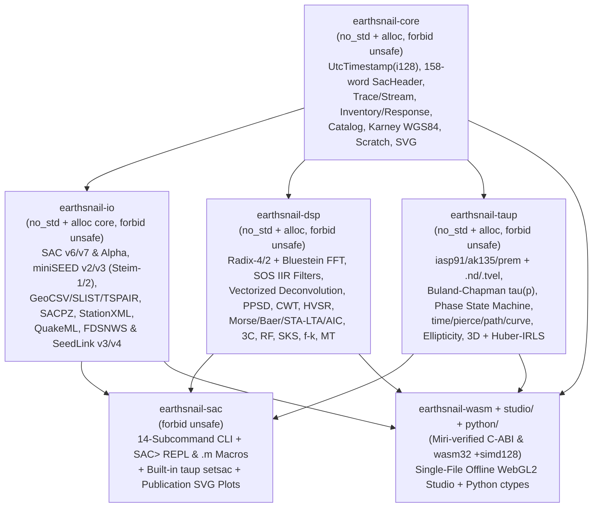

# EarthSnail Architecture & Mathematical Specification

EarthSnail is a clean-room, zero-bloat **100% Rust** seismological engine unifying the waveform manipulation and macro shell of **EarthScope SAC (`sac-community`)**, the analytical planetary ray tracing of the **TauP Toolkit**, and the format, signal-processing, array, and network workflows of **ObsPy** (`core`, `io`, `signal`, `geodetics`, `taup`, `clients.fdsn`, `clients.seedlink`).

Every domain crate compiles with **zero external runtime crate dependencies** (`cargo tree --workspace -e normal` contains only workspace members) and **zero C/Fortran `-sys` bindings** (`0` `libmseed`, `0` `evalresp`, `0` `fftw3`, `0` `libxml2`, `0` `openssl`).

---

## Table of Contents

1. [Six-Crate Topology & Memory Safety Boundary](#1-six-crate-topology--memory-safety-boundary)
2. [Core Time, SAC Header & Karney WGS84 Geodesics (`earthsnail-core`)](#2-core-time-sac-header--karney-wgs84-geodesics-earthsnail-core)
3. [Lossless Codecs, Pull XML & Streaming Clients (`earthsnail-io`)](#3-lossless-codecs-pull-xml--streaming-clients-earthsnail-io)
4. [Spectral, SOS Filter, Deconvolution & Array DSP (`earthsnail-dsp`)](#4-spectral-sos-filter-deconvolution--array-dsp-earthsnail-dsp)
5. [Buland-Chapman TauP Engine & 4D Huber-IRLS Locator (`earthsnail-taup`)](#5-buland-chapman-taup-engine--4d-huber-irls-locator-earthsnail-taup)
6. [Dual-Mode CLI, SAC Macro Engine & W3C SVG Renderer (`earthsnail-sac`)](#6-dual-mode-cli-sac-macro-engine--w3c-svg-renderer-earthsnail-sac)
7. [Miri-Audited C-ABI, WASM32 SIMD & Portable WebGL2 Studio (`earthsnail-wasm`)](#7-miri-audited-c-abi-wasm32-simd--portable-webgl2-studio-earthsnail-wasm)
8. [The 5-Gate Executable Machine-Verification Stack](#8-the-5-gate-executable-machine-verification-stack)

---

## 1. Six-Crate Topology & Memory Safety Boundary



### Architectural Invariants

- **Strict Unsafe Quarantine**: All five domain crates (`earthsnail-core`, `earthsnail-io`, `earthsnail-dsp`, `earthsnail-taup`, `earthsnail-sac`) carry `#![forbid(unsafe_code)]` at the crate root. Raw pointer FFI glue is isolated exclusively inside `earthsnail-wasm` and audited under `cargo +nightly miri` with Stacked/Tree Borrows enabled.
- **Freestanding `#![no_std] + alloc` Portability**: `earthsnail-core`, `earthsnail-dsp`, `earthsnail-taup`, and the codec/XML core of `earthsnail-io` compile without the Rust standard library (`--no-default-features`), backed by a deterministic 53-bit IEEE-754 software transcendental engine (`earthsnail_core::math::soft`) matching hardware `libm` within $\le 2\text{ ULP}$.
- **Caller-Owned `ScratchWorkspace` Reuse**: Hot spectral, filter, deconvolution, and ray-tracing paths accept a reusable `ScratchBuffer` holding split-borrowable `f64`, `Complex64`, and index arenas, eliminating inner-loop heap allocations.
- **Unbounded Trace & Channel Scaling**: Legacy SAC's fixed 200-trace array limit and 32-bit float storage truncation are eliminated; `Trace` samples reside in `Vec<f64>` with `SacHeader` float words promoted to `f64` in memory while preserving exact `-12345.0_f32` binary sentinel semantics on I/O.

---

## 2. Core Time, SAC Header & Karney WGS84 Geodesics (`earthsnail-core`)

### 2.1 Drift-Free Nanosecond Rational Time (`UtcTimestamp(i128)`)

Timestamps are stored as signed 128-bit integer nanoseconds relative to `1970-01-01T00:00:00Z`, spanning $\pm 5.3 \times 10^{21}$ years with exact 1 ns resolution across historical earthquake catalogs and century leap-year boundaries (Howard Hinnant proleptic Gregorian bijection).

Naive floating-point sample indexing accumulates binary representation drift because common seismic sample intervals such as 100 Hz (0.01 s) or 30 Hz (1/30 s) are non-terminating in IEEE-754 binary64. `UtcTimestamp::sample_timestamp` classifies the sampling rate into exact integer Hertz, exact integer nanosecond period, or rational pico-Hertz $R_{\text{pHz}} = \mathrm{round}(10^{12} f_s)$ and evaluates nearest-nanosecond rounded `i128` division:

```math
\Delta t_{\text{ns}}(k) = \left\lfloor \frac{10^{21}\, k + \lfloor R_{\text{pHz}} / 2 \rfloor}{R_{\text{pHz}}} \right\rfloor
```

Across $10^{11}$ samples (over 31 years of continuous 100 Hz telemetry or 3 billion samples at 30 Hz), cumulative timestamp drift is identically $0\text{ ns}$.

### 2.2 Complete 158-Word SAC Header & `LCALDA` Geodesic Coupling

`SacHeader` implements the complete 632-byte ($158 \times 32\text{-bit}$ word) SAC binary specification:
- **Words `0..69` (`280 B`)**: All 70 floating-point variables (`delta`, `depmin`, `depmax`, `b`, `e`, `o`, `a`, `t0..t9`, `f`, `resp0..resp9`, `stla`, `stlo`, `stel`, `stdp`, `evla`, `evlo`, `evel`, `evdp`, `mag`, `user0..user9`, `dist`, `az`, `baz`, `gcarc`, `depmen`, `cmpaz`, `cmpinc`, etc.), promoted to `f64` in memory with lossless SAC v7 22-double (`176 B`) footer support.
- **Words `70..109` (`160 B`)**: All 40 `i32` integer, enumeration (`iftype`, `idep`, `iztype`), and logical (`leven`, `lpspol`, `lovrok`, `lcalda`) variables.
- **Words `110..157` (`192 B`)**: All 24 eight-byte ASCII character slots (23 named `K*` fields with 16-byte `kevnm`).

Whenever `lcalda == 1` and station/event coordinates (`stla`, `stlo`, `evla`, `evlo`) are defined, `SacHeader` automatically recomputes `dist` (km), forward event-to-station `az` (deg), station-to-event `baz` (deg), and `gcarc` (deg) via the WGS84 ellipsoidal inverse solver.

### 2.3 Antipodal-Safe Karney Ellipsoidal Geodesics

Classic Vincenty (1975) iteration stalls or diverges inside the antipodal conjugate astroid ($\phi_1 + \phi_2 \approx 0, \Delta\lambda \approx \pi$) and achieves only $O(f^3) \approx 0.1\text{ mm}$ accuracy. `earthsnail-core::geodesics` solves the exact Bessel–Helmert–Karney auxiliary-sphere boundary value problem on WGS84 ($a = 6\,378\,137.0\text{ m}, f = 1 / 298.257223563$).

Using dihedral symmetry reflections, coordinates are mapped into Karney's canonical sector:

```math
\phi_1 \in [-90^\circ, 0^\circ], \qquad \phi_1 \le \phi_2 \le -\phi_1, \qquad \lambda_{\text{target}} \in [0, \pi]
```

With reduced latitudes $\tan\beta = (1 - f)\tan\phi$ and Clairaut invariant $\sin\alpha_0 = \cos\beta_1 \sin\alpha_1$, the ellipsoidal longitude difference eliminates the polar $\cos^2\beta$ singularity analytically:

```math
\lambda_{12}(\alpha_1) = \omega_{12}(\alpha_1) - f(2 - f)\sin\alpha_0 \int_{\sigma_1}^{\sigma_2} \frac{d\sigma}{1 + (1 - f)\sqrt{1 + k^2 \sin^2\sigma}}, \quad k^2 = e'^2 \cos^2\alpha_0
```

On the canonical domain, the longitude curve is strictly increasing on $\alpha \in [0, \pi]$. Forward-mode dual numbers `(v, dv)` propagate exact analytical derivatives $d\lambda_{12}/d\alpha_1$ through 16-point Gauss–Legendre quadrature inside a bracket-safeguarded Newton–Raphson loop, followed by arc-length integration:

```math
s_{12} = b \int_{\sigma_1}^{\sigma_2} \sqrt{1 + k^2 \sin^2\sigma}\, d\sigma
```

Cancellation-free difference identities preserve full 53-bit precision from sub-millimeter baselines up to exact antipodes, matching `GeographicLib` within $\le 10^{-8}\text{ m}$ ($10\text{ nm}$) and $\le 10^{-11}\text{ deg}$ across all 25 golden coordinate pairs.

---

## 3. Lossless Codecs, Pull XML & Streaming Clients (`earthsnail-io`)

- **Steim-1 & Steim-2 Compression (`steim.rs`)**: Encodes and decodes 64-byte big-endian SEED frames (`15` data words + `1` 32-bit nibble control word `W0` per frame, with frame 0 carrying forward and reverse integration constants `X0` and `Xn`). Steim-2 supports all seven difference packing modes (`4`, `5`, `6`, `8`, `10`, `15`, and `30`-bit signed two's-complement differences via `dnib` sub-codes), while Steim-1 handles full `32`-bit impulses (`c = 0b11`). Decoded streams verify $x[N - 1] \equiv X_n$ identically.
- **miniSEED v2 & v3 (`mseed.rs`, `mseed3.rs`)**: Parses variable record lengths (`256 B..65536 B`), Blockette 100 exact `f32` sample rates, Blockette 1000 encoding/endianness, and Blockette 1001 microsecond timing offsets; miniSEED v3 (`MS` v3, 40-byte little-endian header) supports nanosecond timestamps, `FDSN:NET_STA_LOC_B_S_SS` source identifiers, and Castagnoli CRC-32C integrity verification.
- **Bounded Zero-Dep XML & Metadata (`xml.rs`, `stationxml.rs`, `quakeml.rs`, `sacpz.rs`)**: Pull tokenizer with strict element-depth caps, attribute limits, and DTD entity-expansion rejection (`0` quadratic blowup / `0` XXE attack surface). Parses FDSN `StationXML` `1.0–1.2` multi-stage cascades (`PolesZeros`, `FIR` `NONE`/`ODD`/`EVEN`, `Coefficients`, `Polynomial`, `StageGain`), `SACPZ` displacement pole-zero files, and `QuakeML` `1.2` catalogs.
- **Network & Real-Time Streaming (`fdsn.rs`, `seedlink.rs`)**: Pure-Rust `FdsnClient` (`dataselect`, `station`, `event` GET & bulk POST) and `SeedLinkClient` speaking both SeedLink v3 (`520 B` `"SL"` frames) and SeedLink v4 (`"SE"` variable-length MS2/MS3 packets).

---

## 4. Spectral, SOS Filter, Deconvolution & Array DSP (`earthsnail-dsp`)

### 4.1 Mixed-Radix Cooley–Tukey & Modular-Phase Bluestein FFT

Power-of-two lengths execute in-place mixed radix-4 / radix-2 Cooley–Tukey butterflies with precomputed twiddles and Hermitian half-complex `rfft` / `irfft` packing. Prime and arbitrary composite lengths $N$ reduce exactly to a power-of-two circular convolution of length $M \ge 2N - 1$ via Bluestein's chirp-Z identity $2kn = k^2 + n^2 - (k - n)^2$:

```math
X[k] = W_N^{k^2 / 2} \sum_{n=0}^{N-1} \left(x[n]\, W_N^{n^2 / 2}\right) W_N^{-(k - n)^2 / 2}, \quad W_N = e^{-i 2\pi / N}
```

Evaluating $(k^2 \bmod 2N)$ in `u128` integer arithmetic prior to trigonometric evaluation prevents floating-point phase-wrap loss at large $N$, maintaining Parseval energy conservation within $10^{-13}$.

### 4.2 Analog Prototype Synthesis & Cascaded SOS Filtering

`design_iir_sos` synthesizes arbitrary-order `Butterworth`, `Chebyshev1`, `Chebyshev2`, and `Bessel` (`Phase`, `Delay`, and `Magnitude` normalized up to order 12) lowpass, highpass, bandpass, and bandstop filters:
1. Reverse-Bessel polynomial roots are computed from the Campos–Calderón recursion and polished in **106-bit double-double (`Dd`) arithmetic** via simultaneous Aberth–Ehrlich iteration + Newton steps.
2. Continuous-time poles and zeros undergo pre-warped frequency-band transformation and bilinear mapping:

```math
\omega_a = 2 f_s \tan\!\left(\frac{\pi f_c}{f_s}\right), \qquad z = \frac{2 f_s + s}{2 f_s - s}
```

3. Poles and zeros are paired into $K$ Direct-Form II Transposed Second-Order Sections (`[b0, b1, b2, 1, a1, a2]`) using nearest-unit-circle pole ordering (`pairing = 'nearest'`) to minimize dynamic-range overflow:

```math
H(z) = \prod_{s=1}^{K} \frac{b_{0,s} + b_{1,s} z^{-1} + b_{2,s} z^{-2}}{1 + a_{1,s} z^{-1} + a_{2,s} z^{-2}}
```

Three execution modes are provided: causal single-pass `sosfilt`, classic SAC/ObsPy unpadded two-pass `sosfilt_zerophase_obspy`, and odd-reflection steady-state `sosfiltfilt` solving linear boundary initial conditions $(\mathbf I - \mathbf A)\mathbf z_0 = \mathbf b$ per section.

### 4.3 Vectorized Multi-Stage Instrument Response Deconvolution

For a seismogram spectrum on a uniform frequency grid $f_k = k f_s / N_{\text{fft}}$, the cascaded instrument transfer function combines analog Laplace pole-zero stages ($s = i 2\pi f$) and delay-corrected digital FIR stages. Exploiting the uniform grid spacing, digital stage evaluation advances unit-circle phasors via complex multiplication recurrence rather than per-tap transcendental calls, accelerating 1M-sample multi-stage `StationXML` deconvolution by $>3.5\times$ (`2.63x` faster than ObsPy's C `evalresp`).

Kinematic unit conversion between native sensor derivative order (`DISP = 0`, `VEL = 1`, `ACC = 2`) and target ground-motion output multiplies the response by $(i 2\pi f)^{\Delta q}$, followed by 4-corner SAC cosine pre-filtering $F(f)$ and water-level spectral stabilization:

```math
W = \max_m \lvert H(f_m) \rvert \cdot 10^{-W_{\text{dB}} / 20}, \qquad \hat{U}(f_k) = X(f_k)\, F(f_k)\, \frac{H^\ast(f_k)}{\max\!\left(\lvert H(f_k) \rvert^2,\; W \lvert H(f_k) \rvert\right)}
```

### 4.4 Glitch-Immune Morse Picking, Array Beamforming & Moment Tensors

- **3-Point Discrete Morse Picker (`morse_pick`)**: Evaluates backward and forward differences with discrete Morse impulse product $I[n] = (x[n] - x[n-1])(x[n] - x[n+1])$ and 1-sample causal persistence deferral, rejecting single-sample telemetry spikes (`0` false triggers) while preserving impulsive P-wave onsets alongside `pk_baer`, `aic_pick`, and classic/recursive `STA/LTA`.
- **Frequency-Wavenumber (`f-k`) Beamforming**: Computes narrowband cross-spectral density matrices $\mathbf R(f)$ across 2D slowness grids $\mathbf s = (s_x, s_y)$ with steering vectors, supporting both Bartlett conventional power and diagonally loaded Capon MVDR adaptive beamforming:

```math
P_{\text{conv}}(\mathbf s) = \mathbf a^H \mathbf R \mathbf a, \qquad P_{\text{MVDR}}(\mathbf s) = \frac{1}{\mathbf a^H (\mathbf R + \delta\mathbf I)^{-1} \mathbf a}
```

- **Moment Tensor Eigendecomposition (`moment_tensor.rs`)**: Cyclic $3 \times 3$ Jacobi diagonalization decomposes symmetric moment tensors $\mathbf M$ (in Harvard `Up-South-East` or Aki–Richards `North-East-Down` bases) into principal `T`/`N`/`P` axes, scalar seismic moment, Kanamori moment magnitude $M_w = \tfrac{2}{3}(\log_{10} M_0 - 9.1)$, and exact `ISO + DC + CLVD` percentages.

---

## 5. Buland-Chapman TauP Engine & 4D Huber-IRLS Locator (`earthsnail-taup`)

### 5.1 Bullen Power-Law Slowness Layers & Analytical $\tau(p)$ Integration

`earthsnail-taup` embeds `iasp91`, `ak135`, and `prem` as zero-I/O compile-time tables (`const`) and compiles custom `.nd` and `.tvel` planetary models at runtime. Within each spherical shell $[r_b, r_t]$ where spherical slowness $\eta(r) = r / v(r)$ follows Bullen's power law $\eta(r) = A r^B$, horizontal slowness $p$ satisfies exact analytical distance and delay-time integrals (free of numerical quadrature or turning-point singularity discretization error):

```math
\Delta(p) = \sum_{\text{legs}} \int_{r_{\min}}^{r_{\max}} \frac{p}{r\sqrt{\eta(r)^2 - p^2}}\, dr, \qquad \tau(p) = \sum_{\text{legs}} \int_{r_{\min}}^{r_{\max}} \frac{\sqrt{\eta(r)^2 - p^2}}{r}\, dr
```

By Legendre duality, $d\tau / dp = -\Delta(p)$ and travel time satisfies $T(p) = \tau(p) + p\,\Delta(p)$. Low-velocity zones (`LVZ`, such as PREM's upper-mantle lid) track diffracted/shadow slowness intervals without branch tearing. Root-finding for target epicentral distance $\Delta_{\text{obs}}$ brackets monotone slowness cells via Cubic Hermite $\tau(p)$ interpolation polished by safeguarded Dekker–Brent iteration.

### 5.2 3D Perturbation & Huber-IRLS 4D Hypocenter Inversion

`locate_hypocenter` seeds candidate hypocenters from a Fibonacci-sphere + station-centroid multi-depth grid and solves for hypocentral state $\mathbf m = (\phi, \lambda, z, t_0)^T$ via Levenberg–Marquardt damped Iteratively Reweighted Least Squares (`IRLS`) with Huber residual weights:

```math
w_i = \min\!\left(1,\; \frac{k}{\lvert r_i / \hat{\sigma} \rvert}\right), \qquad \delta\mathbf m = \left(\mathbf G^T \mathbf W \mathbf G + \lambda \mathbf I\right)^{-1} \mathbf G^T \mathbf W \mathbf r, \qquad \boldsymbol{\Sigma} = \hat{\sigma}^2 \left(\mathbf G^T \mathbf W \mathbf G + \lambda \mathbf I\right)^{-1}
```

Optional Dziewonski–Gilbert WGS84 ellipticity corrections and Um & Thurber (1987) 3-point pseudo-bending 3D slab/plume ray perturbations integrate directly into the forward travel-time operator.

---

## 6. Dual-Mode CLI, SAC Macro Engine & W3C SVG Renderer (`earthsnail-sac`)

`earthsnail-sac` exposes two unified operator interfaces over the domain crates:
1. **Structured Modern CLI (`earthsnail <subcommand>`)**: Deterministic RFC-8259 `--json` and file pipelines across `inspect`, `convert`, `filter`, `transfer`, `pick`, `taup` (`time`, `pierce`, `path`, `curve`, `setsac`, `locate`), `ppsd`, `rf`, `fk`, `plot`, `fdsn`, `seedlink`, `verify`, and `sac`.
2. **Interactive `SAC>` Shell & `.m` Macro Runner (`earthsnail sac` / `es-sac`)**: Supports classic SAC command abbreviations (`r`, `w`, `lh`, `ch`, `rmean`, `rtrend`, `taper`, `bp`, `lp`, `hp`, `br`, `transfer`, `cut`, `cutim`, `merge`, `sort`, `rot`, `apk`, `fft`, `mul`, `div`, `add`, `sub`, `dif`, `int`, `interpolate`, `decimate`, `p1`, `p2`, `prs`, `spectrogram`, `beachball`, `plottaup`), positional macro arguments (`1..9`) and keyword defaults, `setbb`/`getbb` blackboard variables, inline arithmetic expressions, multi-level `undo`, and native `taup` arrival stamping into `T0..T9` / `KT0..KT9`.
3. **Publication W3C SVG 1.1 Renderer (`plot.rs`)**: Generates standalone vector figures (`plot_waveforms_svg`, `plot_record_section_svg`, `plot_spectrogram_svg`, `plot_ppsd_svg`, `plot_taup_paths_svg`, `plot_beachball_svg`) using `earthsnail-core::svg` with strict XML entity escaping.

---

## 7. Miri-Audited C-ABI, WASM32 SIMD & Portable WebGL2 Studio (`earthsnail-wasm`)

- **33-Function C-ABI & Wire Protocol (`wire.rs`)**: Exposes flat `extern "C"` entrypoints (`es_alloc`, `es_free`, `es_read_waveforms`, `es_filter_trace`, `es_remove_response`, `es_taup_travel_times`, `es_taup_ray_paths`, `es_morse_pick`, `es_moment_tensor_decompose`, etc.) communicating over 8-byte-aligned little-endian binary frames (`ESWF`, `ESTT`, `ESRP`, `ESPP`) with a `512 MiB` allocation guard and zero-heap thread-local error slot.
- **Zero-Install WebGL2 + `WASM32 +simd128` Workstation (`studio/earthsnail_portable_studio.html`)**: Single self-contained HTML file (`0` external CDN/network requests) embedding the compiled `wasm32-unknown-unknown` `+simd128` binary (`4,236` `v128` SIMD instructions) and real 3-component `2011 Mw 9.1 Tohoku-Oki` broadband telemetry (`G.CAN.00.BH*`), providing 60-fps WebGL2 waveform picking, real-time SOS filtering & `StationXML` deconvolution, `PPSD` & Morlet spectrogram panels, interactive `TauP` Earth cutaway ray paths, `ISO/DC/CLVD` beachball rendering, and an in-browser `SAC>` console.
- **Zero-Dependency Python Bindings (`python/earthsnail/`)**: Pure-stdlib `ctypes` wrapper (`dependencies = []` in `pyproject.toml`) unpacking `array('d')` buffers directly from `earthsnail_wasm` shared libraries on Windows (`.dll`), Linux (`.so`), and macOS (`.dylib`).

---

## 8. The 5-Gate Executable Machine-Verification Stack

Every release must satisfy all five automated executable verification gates:

| Gate | Verification Scope | Enforced Mathematical / Systems Contract |
| :--- | :--- | :--- |
| Gate 1 — Differential Oracle Parity | Frozen golden fixtures generated by `ObsPy 1.5.1`, `SciPy 1.18.1`, `GeographicLib 2.1`, and `TauPy` (`101/101` release test suites) | `0` bit error on integer Steim-1/2 & SAC BE/LE; $\le 10^{-6}\text{ m}$ and $\le 10^{-9}\text{ deg}$ on 25 WGS84 geodesic regimes; $\le 10^{-10}$ on 36 SOS filter modes; $\le 10^{-9}$ rel error on 3-stage `StationXML` `remove_response`; $\le 5 \times 10^{-3}\text{ s}$ across 2,926 `iasp91`/`ak135`/`prem` `TauP` arrivals |
| Gate 2 — `cargo miri` Soundness | `cargo +nightly miri test --workspace --lib` (including `--no-default-features` & `earthsnail-wasm` FFI) | `0` undefined behavior, `0` memory leaks, strict Stacked/Tree Borrows compliance even under aliased `in_ptr == out_ptr` FFI calls |
| Gate 3 — `proptest` Invariants | Randomized algebraic & physical property suites across all domain crates | Lossless Steim-1/2 & MS2/MS3 round-trip; FFT Parseval $\sum \lvert x \rvert^2 = \frac{1}{N}\sum \lvert X \rvert^2$ to $\lt 10^{-11}$; SOS pole stability $\lvert z \rvert \lt 1$ & zero passband phase shift; Legendre identity $T(p) = \tau(p) + p\Delta(p)$ & Snell's law $\eta(r)\sin i(r) = p$ |
| Gate 4 — Adversarial Torture Corpus | Truncated headers, corrupted Steim nibbles, `NaN`/`Inf` floats, negative/huge `NPTS`, DTD XML bombs, malformed phases & macros | `100%` typed `Err(EarthSnailError)` returns; `0` panics, `0` arithmetic traps, `0` unbounded allocations |
| Gate 5 — Cross-ISA WASM32 Lockstep & Benchmarks | Identical workloads executed on native `x86_64` and `wasm32-unknown-unknown (+simd128)` + uncontended `ObsPy` head-to-head benchmarks | `0` ULP codec parity and deterministic cross-ISA agreement (`studio/wasm_lockstep_receipts.json`) alongside measured latency & `PeakWorkingSetSize` RSS receipts (`results/benchmark_summary.json`) |
